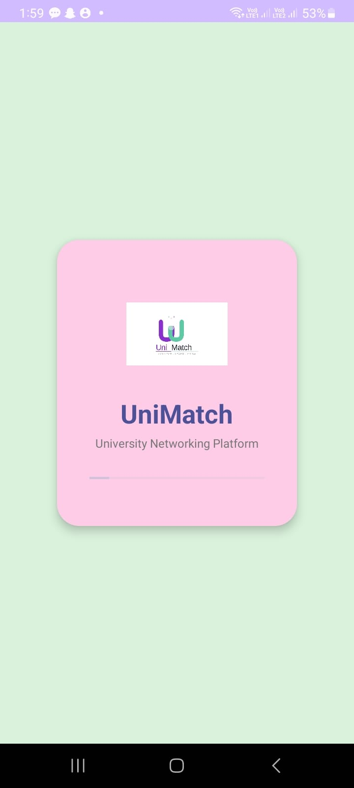
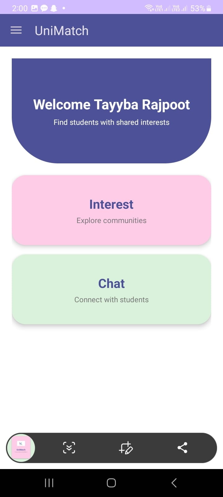
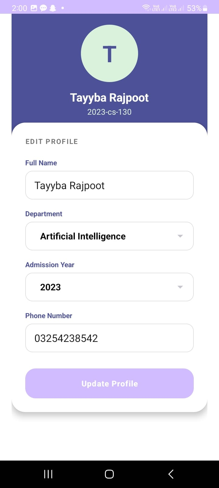
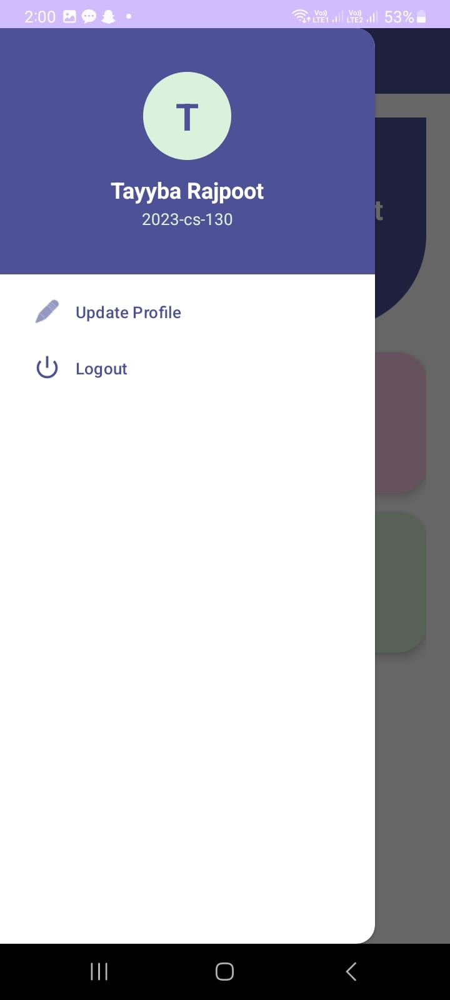
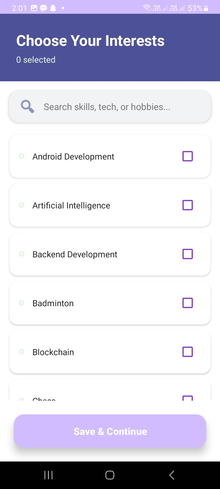
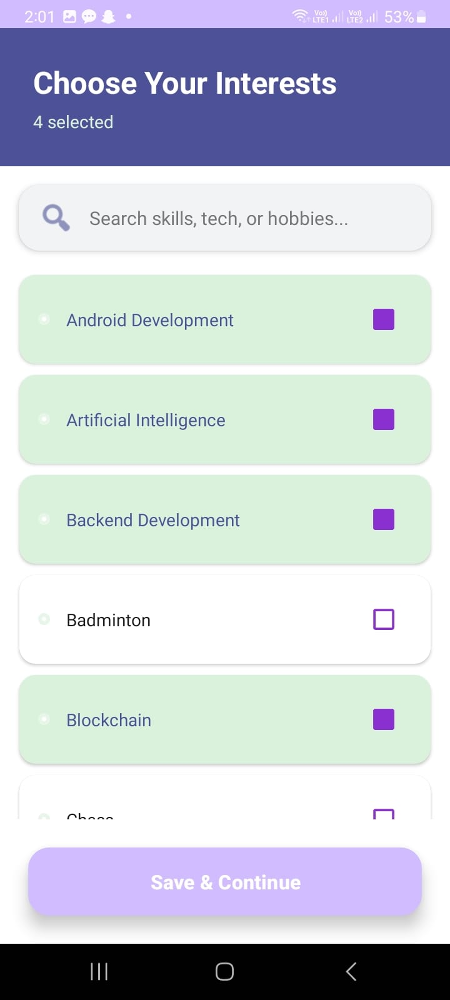
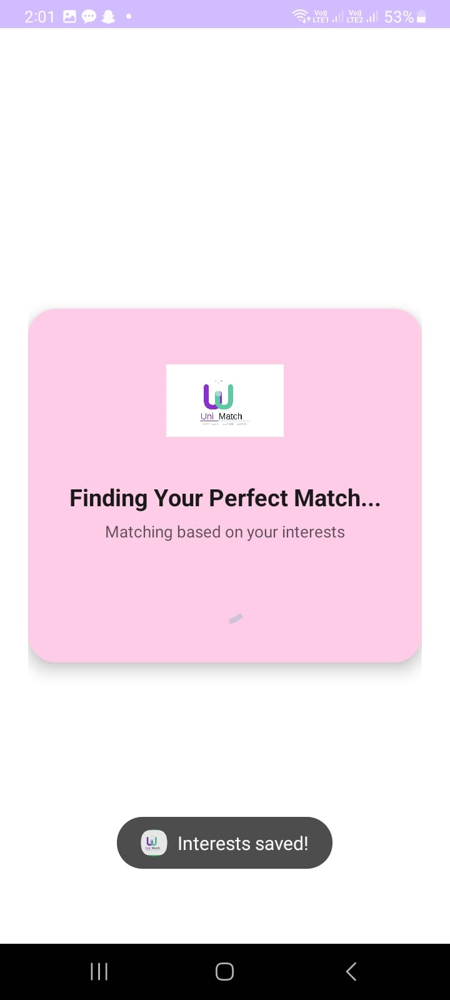
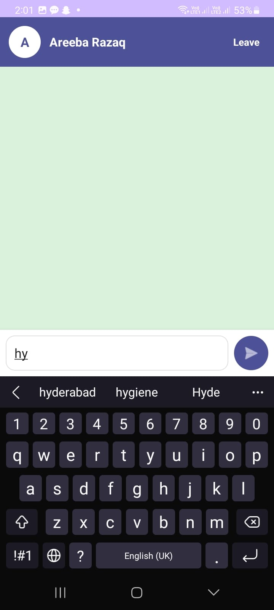
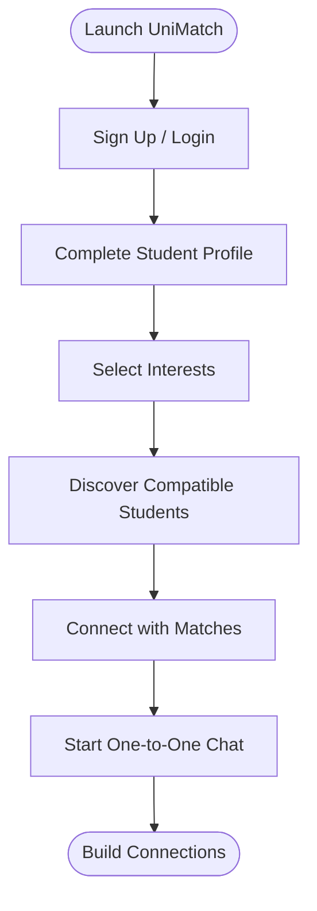

# 🎓 UniMatch

### Connect. Match. Communicate.

**UniMatch** is an Android social networking application designed to help university students discover and connect with people who share similar interests. Students can create profiles, explore common interests, find compatible matches, and communicate through real-time one-to-one messaging.

<p align="center">
  
  
  
</p>

---

## ✨ Key Features

| Feature | Description |
|---|---|
| 🔐 **User Authentication** | Secure sign-up and login using Firebase Authentication with email verification. |
| 👤 **Profile Management** | Create and update personal profiles and university registration details. |
| ❤️ **Interest Selection** | Select and manage personal interests to discover like-minded students. |
| 🎯 **Interest-Based Matching** | Find potential connections based on shared interests. |
| 💬 **Real-Time Chat** | Communicate with matched students through one-to-one messaging. |
| 📊 **Interactive Dashboard** | Animated dashboard providing access to the application's main features. |
| ☰ **Navigation Drawer** | Convenient access to profile settings and logout functionality. |

---

## 📱 App Screenshots

Explore the UniMatch experience, from the initial splash screen to discovering compatible students and connecting through chat.

### 🚀 Getting Started

<p align="center">
  
  
</p>

### 👤 Profile & Navigation

<p align="center">
  
  
</p>

### ❤️ Interests & Preferences

<p align="center">
  
  
</p>

### 🎯 Matching & Communication

<p align="center">
  
  
</p>

---

## 🔄 How UniMatch Works

The application follows a simple process to help students build meaningful connections.



---

## 🛠️ Tech Stack

| Technology | Purpose |
|---|---|
| **Kotlin** | Primary programming language |
| **Android SDK** | Native Android application development |
| **Firebase Authentication** | User registration and authentication |
| **Cloud Firestore** | Cloud database for user profiles, interests, and messaging data |
| **Material Design** | UI components and interface styling |
| **ConstraintLayout** | Flexible Android layouts |
| **RecyclerView** | Displaying dynamic lists and conversations |
| **CardView** | Structured and visually organized UI components |

---

## 📂 Project Structure

The application is organized around dedicated activities and reusable utility components.

```text
UniMatch/
│
├── app/
│   └── src/
│       └── main/
│           ├── java/
│           │   └── .../
│           │       ├── MainActivity
│           │       ├── DashBoardActivity
│           │       ├── LoginScreen
│           │       ├── SignUp
│           │       ├── InterestActivity
│           │       ├── ChatListActivity
│           │       ├── ActivityChat
│           │       ├── User_registration
│           │       └── Profilee
│           │
│           ├── res/
│           │   ├── layout/
│           │   ├── drawable/
│           │   └── values/
│           │
│           └── AndroidManifest.xml
│
├── screenshots/
│   ├── splash.jpeg
│   ├── dashboard.jpeg
│   ├── drawer.jpeg
│   ├── interest_screen.jpeg
│   ├── match_logic.jpeg
│   ├── profile.jpeg
│   ├── selected_interest.jpeg
│   └── chat.jpeg
│
├── gradle/
├── build.gradle.kts
├── settings.gradle.kts
└── README.md
```

---

## 🚀 Getting Started

Follow these steps to set up UniMatch locally.

### Prerequisites

- Android Studio
- Android SDK
- JDK compatible with the project's Gradle configuration
- A Firebase account

### Installation

**1. Clone the repository**

```bash
git clone https://github.com/tayyba678/UniMatch.git
```

**2. Open the project**

Open the cloned project in Android Studio and allow Gradle to synchronize.

**3. Configure Firebase**

- Create a project in the [Firebase Console](https://console.firebase.google.com/).
- Register an Android application using the package name `com.example.unimatch`.
- Download the `google-services.json` configuration file.
- Place the file inside the `app/` directory.
- Enable Email/Password authentication in Firebase Authentication.
- Create a Cloud Firestore database.
- Configure appropriate Firestore security rules.

**4. Run the application**

- Connect an Android device or start an emulator.
- Complete Gradle synchronization.
- Build and run the application from Android Studio.

---

## 🎯 Project Goals

UniMatch was developed to make university social connections easier and more meaningful.

The main objectives include:

- Providing a secure student registration and authentication system.
- Enabling students to manage their profiles and interests.
- Discovering compatible students through shared preferences.
- Facilitating real-time communication between matched users.
- Delivering an interactive and user-friendly Android experience.

---

## 👩‍💻 Developer

**Tayyba Aftab**

Computer Science Student | Android Development

- GitHub: [@tayyba678](https://github.com/tayyba678)
- Project Repository: [UniMatch](https://github.com/tayyba678/UniMatch)


<p align="center">
  <b>UniMatch — Bringing University Students Closer! 💜</b>
</p>
